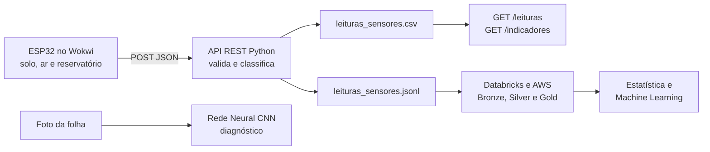

# Heimdall

**O vigia que protege o alimento do campo à mesa.**

Visão, públicos, papel de cada disciplina e regras de entrega: [`CONTEXTO_HEIMDALL.md`](CONTEXTO_HEIMDALL.md).

Quadro Kanban do projeto (Trello): https://trello.com/b/ZerD4f4V/heimdall-gs-20262

Global Solution 2026.2 (CitizenTech) - FIAP - Tecnólogo em Inteligência Artificial, turma 1TIAPY

| Integrante | RM | Disciplinas |
|---|---|---|
| Adalberto Alves Cruz | RM574115 | Computational Thinking with Python, Cognitive Cybersecurity, AI Challenge |
| Danilo Keithi Makiya Nakasone | RM574137 | Cognitive Data Science (Databricks), Plataformas Cognitivas (AWS), Statistical Computing with R & Python |
| Gustavo da Silva Nascimento | RM570821 | AI Computer Systems & Sensors, Machine Learning, Redes Neurais |

## O problema

O alimento se perde em duas fases. No campo, a seca mata a planta antes da colheita. Depois da colheita, o calor acelera o apodrecimento no galpão, no transporte e na prateleira. O Heimdall monitora solo, temperatura e reservatório, decide a irrigação na hora de tarifa mais barata e aponta os lotes em risco para venda rápida ou doação pelo PAA antes que estraguem.

Público: do pequeno produtor e do sacolão de bairro até cooperativas, redes de varejo e programas públicos.

## Arquitetura



## Contrato JSON único

Todas as disciplinas usam exatamente estas chaves (textos sem acento):

```json
{"id_sensor":"S01","fazenda":"Sitio Boa Esperanca","cultivo":"Tomate","umidade":28.4,"temperatura":33.1,"umidade_ar":41.0,"nivel_reservatorio":62.0,"status_umidade":"ALERTA","status_temperatura":"OK","status_reservatorio":"OK","bomba":true,"risco_perda_lote":"BAIXO","motivo":"SOLO_SECO_JANELA_DESCONTO","data_hora":"2026-11-12 22:15:00"}
```

Motivos possíveis, em ordem de prioridade: `BLOQUEIO_RESERVATORIO_BAIXO`, `ALERTA_CALOR_EXTREMO`, `IRRIGACAO_EMERGENCIAL_SOLO_CRITICO`, `SOLO_SECO_JANELA_DESCONTO`, `AGUARDANDO_JANELA_DESCONTO`, `CONDICOES_ESTAVEIS`.

## Estrutura do repositório

| Pasta | Conteúdo | Responsável |
|---|---|---|
| [`api/`](api/) | API REST (FastAPI), versão segura e validador de ataques | Adalberto |
| [`esp32/`](esp32/) | código do ESP32 e diagrama do Wokwi | Gustavo |
| [`machine-learning/`](machine-learning/) | previsão da umidade do solo em 24 h (base CEMADEN) | Gustavo |
| [`redes-neurais/`](redes-neurais/) | CNN para doenças foliares do tomate (PlantVillage) | Gustavo |
| [`dados/`](dados/) | arquivo oficial de leituras, Databricks, AWS e estatística | Danilo |
| [`docs/`](docs/) | diagramas UML, Kanban e roteiro do vídeo integrador | Adalberto |

## Como rodar a API

```
cd api
pip install -r requirements.txt
uvicorn app:app --host 0.0.0.0 --port 8000
```

Detalhes em [`api/README.md`](api/README.md) e, para a versão segura, em [`api/SEGURANCA.md`](api/SEGURANCA.md).

## ODS

ODS 2 (Fome Zero e Agricultura Sustentável), ODS 9 (Indústria, Inovação e Infraestrutura), ODS 10 (Redução das Desigualdades) e ODS 13 (Ação Contra a Mudança Global do Clima).
